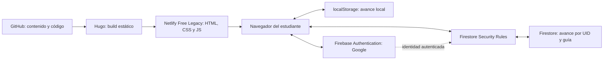

# Sistema de estudiantes y sincronización Firebase: documentación para auditoría

Fecha de revisión: **24 de octubre de 2026**. Sitio: **Las Notas de Vero**. Guía implementada: **Lucas**.

Este documento describe el código local existente, las comprobaciones registradas y los límites conocidos. No certifica que el sistema haya superado una auditoría de seguridad. Se distingue entre implementación, pruebas automatizadas, verificaciones anteriores del despliegue y confirmaciones de la titular. No contiene información de estudiantes ni credenciales.

## 1. Estado y alcance

El sistema permite estudiar libremente, guardar avance en el navegador y, opcionalmente, vincularlo a una cuenta Google para recuperarlo en otros dispositivos. No implementa matrículas, calificaciones, corrección de respuestas, panel docente ni un listado administrativo de estudiantes.

| Entorno | Proyecto o ubicación | Estado documentado |
| --- | --- | --- |
| Sitio principal | `lasnotasdevero.com` / `www.lasnotasdevero.com`; Firebase `lnv-data` | Despliegue `6adc3e9fa00c0635b0b49e56` publicado; sincronización, App Check y protección del almacenamiento activos. HTTP y token real de App Check verificados; guardado autenticado en producción todavía no comprobado. |
| Ensayo real en internet | [Guía de prueba](https://lucas-firebase-test-20261023--lasnotasdevero.netlify.app/estudios/guia-estudio-lucas/); Firebase `lnv-test` | Borrador separado con sincronización habilitada; nunca comparte datos con `lnv-data`. |
| Ensayo local con Google | Vista temporal generada por `scripts/preview-firebase.mjs` | Usa proyecto de pruebas separado; requiere configuración explícita. |
| Pruebas automatizadas de reglas y proveedor | `demo-lasnotasdevero`, Auth y Firestore emulados en loopback | Identidades sintéticas; no utiliza proyectos de estudiantes. |

Estado revisado el 24 de octubre de 2026: la titular confirmó Spark sin facturación, Google Authentication, dominios autorizados, App Check y reglas publicadas en `lnv-data`; no hubo inspección administrativa independiente. El código final pasó 107/107 pruebas Node con red bloqueada, 13/13 reglas en emuladores demo, provider real con Auth/Firestore emulados, navegador de cuatro pestañas/cinco casos y revisión/diff. El render Hugo 0.124.1 de privacidad generó 311 HTML sin scripts externos, RefTagger ni filtraciones privadas; se activaron temporalmente flags de render, con Firebase desactivado y salida no deployable. El borrador `6adc3861ca255b5cafec6232` está `ready`; la titular confirmó funcionamiento con dos cuentas entre PC y teléfono. Tras la pausa histórica por HTTP 400, se publicó `6adc3e9fa00c0635b0b49e56` con Sync, App Check y protección del almacenamiento activos. HTTP y la obtención real de un token de App Check posterior a publicar pasaron; falta comprobar un guardado autenticado en el dominio principal. El borrado consulta IDs de curso del registro del cliente y limita cada recorrido a 200 documentos; no escanea cursos quitados del registro central. No hay respaldo central privado implementado. Los detalles están en [implementación multipestaña](progreso-multipestana-implementacion.md) y [revisión de preparación](production-readiness.md); las secciones históricas posteriores de este informe conservan evidencia anterior.

Tras el último cambio del acceso Google, la titular informó «funciona bien». Es una confirmación funcional general; no sustituye un registro individual de todas las pruebas de seguridad, borrado y recuperación.

## 2. Arquitectura y responsabilidades



Hugo y Netlify entregan archivos estáticos. El navegador utiliza el SDK modular oficial para hablar directamente con Firebase Authentication y Firestore. La autorización se ejecuta en Firestore Security Rules, en los servidores de Firebase. No hay un servidor propio que reciba o valide sesiones para esta integración.

Los nombres `session`, `auth/login`, `progress GET/PUT/DELETE` y `account/delete` que aparecen en JavaScript son operaciones de una interfaz interna del proveedor. **No son endpoints HTTP propios publicados en Netlify.**

La implementación anterior de Netlify Identity, Blobs y Functions está conservada en archivos heredados y no es el proveedor activo. Sus dependencias y pruebas todavía pueden aparecer en el proyecto. El script antiguo de backups no respalda Firebase.

## 3. Archivos que debe revisar quien audite

Las rutas de esta tabla son relativas a la raíz del repositorio.

| Archivo o directorio | Responsabilidad |
| --- | --- |
| [layouts/estudios/study-guide.html](../layouts/estudios/study-guide.html) | Encabezado, barra, botón Google, elección de avances y herramientas de cuenta. |
| [static/js/study-guide.js](../static/js/study-guide.js) | Navegación, estados visuales, guardado local y controlador del progreso activo. |
| [static/js/study-progress.js](../static/js/study-progress.js) | Modelo JSON v1, validación local, combinación por campo e IDs estables. |
| [static/js/study-sync.js](../static/js/study-sync.js) | Exportación/importación, consentimiento, coordinación de sincronización, reintentos y cambio de cuenta. |
| [assets/js/study-firebase-provider.js](../assets/js/study-firebase-provider.js) | SDK de Auth/Firestore, validación del envío, transacciones y borrados. Fuente editable del proveedor. |
| [static/js/study-firebase.bundle.js](../static/js/study-firebase.bundle.js) | Artefacto compilado que recibe el navegador; no editar a mano. |
| [scripts/build-firebase.mjs](../scripts/build-firebase.mjs) | Extrae catálogo del Markdown y genera reglas y bundle. |
| [firebase/courses.json](../firebase/courses.json) | Registro de guías; actualmente solo `lucas`. |
| [firebase/firestore.rules](../firebase/firestore.rules) | Reglas generadas: propietario, esquema, IDs y transiciones permitidas. |
| [firebase/firestore.indexes.json](../firebase/firestore.indexes.json) | Configuración de índices preparada. |
| [firebase/firebase.json](../firebase/firebase.json) | Configuración de reglas y emuladores. |
| [static/config/firebase.json](../static/config/firebase.json) | Configuración web pública de producción y `enabled: false`. |
| [config/_default/config.toml](../config/_default/config.toml) | Interruptores de Hugo; producción apagada. |
| [themes/vero/layouts/partials/head.html](../themes/vero/layouts/partials/head.html) | CSP de la guía y protección del almacenamiento frente a scripts externos. |
| [assets/js/study-app-check.js](../assets/js/study-app-check.js) | Preparación opcional de App Check, limitada a lnv-test y sin renovación periódica. |
| [tests/firebase-app-check.test.mjs](../tests/firebase-app-check.test.mjs) | SDK simulado: carga diferida, tokens, configuración y errores; sin evaluaciones reales. |
| [scripts/preview-firebase.mjs](../scripts/preview-firebase.mjs) | Construcción aislada con Firebase de pruebas, sin modificar los interruptores de producción. |
| [netlify.toml](../netlify.toml) | Build estático y directorio local de Functions sin puntos de entrada desplegables. |
| [static/styles/study-guide.css](../static/styles/study-guide.css) | Presentación adaptable y estilo del botón Google. |
| [static/fonts/google-sans/SOURCES.txt](../static/fonts/google-sans/SOURCES.txt) | Procedencia del icono/fuente de Google; licencia junto al archivo. |
| [docs/firebase-sincronizacion.md](firebase-sincronizacion.md) | Historial técnico de implementación, configuración y comprobaciones anteriores. |

La carpeta `.lucas-private/` contiene configuración local de pruebas y está ignorada por Git. `.contact-test-output/` contiene builds, capturas e informes temporales ignorados. No deben incorporarse completos al repositorio ni servirse como raíz pública.

## 4. Experiencia del estudiante

### 4.1. Estudio sin cuenta

No se necesita cuenta para leer las preguntas o reproducir los videos. Con JavaScript, la guía muestra una clase a la vez, navegación lateral en escritorio y selector en celular. Al cambiar de clase se retira el iframe anterior y se crea el de la clase seleccionada. El estado no mide los minutos vistos en YouTube ni comprueba que se haya terminado de ver un video.

Se registran las marcas de bloques trabajados, la finalización explícita de una clase, la clase seleccionada y el último punto recordado. Abrir una pregunta puede guardar la posición de lectura; no la marca automáticamente como trabajada. Completar todos los bloques tampoco completa automáticamente la clase: existe un botón específico para eso.

La barra suma las actividades publicadas presentes en el catálogo renderizado. Actualmente hay **nueve**: seis clases principales, dos complementos y una integración. Los **13 videos previstos** se informan por separado y no son el denominador actual. El desglose distingue las tres categorías.

### 4.2. Ingreso con Google

1. El botón «Iniciar sesión con Google», junto a la barra, aparece cuando la sincronización está habilitada y el SDK ha resuelto que no hay sesión activa.
2. Se abre el popup oficial con selección de cuenta. El sitio no pide ni almacena contraseñas.
3. Firebase entrega al SDK la identidad autenticada. El cliente escucha `onAuthStateChanged` y obtiene el UID desde esa sesión.
4. Si hay avance local —incluida una posición de lectura o una marca explícita desmarcada—, `inspect()` consulta el avance remoto sin activar otro perfil ni escribir datos.
5. Se comprueba nuevamente que la cuenta sigue siendo la misma antes de mostrar la decisión.

| Situación | Comportamiento |
| --- | --- |
| Avance local y progreso en la cuenta | Informa que existen ambos y pregunta cuál usar. |
| Avance local y cuenta vacía | Aclara que la cuenta todavía no tiene progreso; no afirma que exista una copia remota. |
| Sin avance local | Abre directamente el avance de la cuenta, sin una elección innecesaria. |
| Cancelación del popup | Conserva el modo local. |
| Fallo al consultar la cuenta | Conserva el avance local y ofrece reintentar; no interpreta un error como cuenta vacía. |

La elección ofrece **«Combinar ambos avances»** y **«Usar progreso de mi cuenta Google»**. Combinar incorpora el avance anónimo mediante las fechas de cada campo. Usar la cuenta no incorpora ese avance anónimo ni lo borra. Desde las herramientas inferiores se puede incorporarlo después con «Incorporar avance guardado sin cuenta».

Antes de aplicar la elección se realiza otra lectura remota, porque otra sesión pudo modificar el progreso mientras se mostraba el aviso. Se comprueban el UID esperado y el contexto de la operación. Una notificación repetida de la misma sesión no debe saltarse la elección pendiente.

**Matiz para auditoría:** usar la cuenta no significa descartar todos los cambios privados del mismo usuario en ese dispositivo. Si existe una copia privada de la misma generación, se combina con la remota para conservar modificaciones locales todavía no subidas. La copia anónima sigue separada.

### 4.3. Sesión, recarga y cierre

Auth usa `browserSessionPersistence`: conserva la sesión de la pestaña al recargar, en lugar de configurar una sesión permanente. La persistencia de Auth es distinta de la copia de progreso en `localStorage`. El comportamiento esperado de esta modalidad está documentado por [Firebase](https://firebase.google.com/docs/auth/web/auth-state-persistence).

Después de F5, `resume()` solo recupera una conexión anterior si el SDK reconoce el UID y existen su copia privada válida y su marcador de generación. Vuelve a consultar Firestore; no incorpora automáticamente la copia anónima. Mientras se recupera el estado, la barra es indeterminada y muestra «Recuperando tu avance…», para evitar presentar un cero transitorio como avance de la cuenta.

«Guardar y cerrar sesión» intenta confirmar los cambios pendientes inmediatamente, sin esperar los siete segundos del guardado agrupado. Espera también un envío en curso y puede realizar un segundo envío para cubrir una edición que llegó durante el primero. Las salidas simultáneas se agrupan. La copia local solo se retira cuando no quedan cambios pendientes de confirmar.

Si Firebase falla, se conserva la copia privada y su generación, con un marcador `:pending` por UID. Después se cierra la sesión, se reactiva el avance anónimo y se informa que los pendientes siguen en ese dispositivo. No se envían datos de esa copia después de salir: se recuperan al volver a ingresar con el mismo UID, comprobar la generación remota y abrir el avance de la cuenta. La elección de combinar o usar la cuenta sigue vigente cuando existe avance anónimo; no se incorpora de forma implícita.

Si tampoco se puede confirmar que el navegador guardó los pendientes —por ejemplo, almacenamiento lleno o denegado—, se mantiene abierta la copia en memoria y se informa que debe exportarse o reintentarse; no se da por cerrado el proceso ni se afirma que exista un respaldo local. Cerrar sesión de Firebase no cierra la sesión general de Google en otros servicios. Si falla `signOut`, el aviso también debe distinguir esa situación.

Cerrar una pestaña no ejecuta por sí mismo una limpieza garantizada del `localStorage`; la copia privada puede permanecer allí. Se requiere evaluar este comportamiento en equipos compartidos. Los controles del SDK evitan abrir otra cuenta desde la interfaz, pero no cifran los archivos del navegador frente a alguien con acceso al mismo perfil.

## 5. Modelo de datos y almacenamiento

### 5.1. Progreso local

Lucas conserva la clave `lasnotasdevero:lucas:progress:v1`. La copia privada utiliza el sufijo `:account:{UID codificado}`; sus marcadores añaden `:generation` y, cuando hay cambios sin confirmar, `:pending`. Este último es estado local, no una prueba de identidad ni un campo nuevo en Firestore. Otras guías utilizan una clave basada en su `course_id`.

Ejemplo sintético de progreso; las fechas son milisegundos desde Unix epoch y no pertenecen a una persona:

```json
{
  "version": 1,
  "selected": { "value": "video-1", "updatedAt": 1700000000000 },
  "classes": {
    "video-1": {
      "blocks": {
        "historia-y-fe": { "value": true, "updatedAt": 1700000000000 }
      },
      "complete": { "value": false, "updatedAt": 1700000000001 },
      "lastPoint": { "value": "1-historia-y-fe", "updatedAt": 1700000000000 },
      "lastActivity": { "value": 1700000000001, "updatedAt": 1700000000001 }
    }
  },
  "lastActivity": { "value": 1700000000001, "updatedAt": 1700000000001 }
}
```

El navegador guarda inmediatamente los cambios del perfil activo, antes de esperar a la nube. El reloj local avanza de forma monótona dentro del controlador para evitar retroceder respecto de la última actividad conocida. Datos corruptos, de una versión futura o almacenamiento denegado se informan; el archivo original no se sobrescribe silenciosamente y la visita puede continuar en memoria.

No hay cifrado propio ni cifrado de extremo a extremo. `localStorage` se comparte por origen y perfil del navegador. La vista de prueba y el dominio principal tienen espacios locales distintos. Cambiar de dominio, borrar los datos del navegador o usar otro perfil no traslada por sí mismo la copia anónima.

### 5.2. Firestore

```text
students/{uid}/guides/{courseId}
students/{uid}/guides/{courseId}/classes/{classId}
students/{uid}  ← solo marcador de eliminación de cuenta, cuando existe
```

El documento padre `students/{uid}` **no es una ficha del estudiante**. Su ausencia permite trabajar; su existencia se interpreta como bloqueo de eliminación. Las subcolecciones pueden existir sin ese documento padre.

| Documento | Campos |
| --- | --- |
| Resumen de guía | `schema`, `revision`, `generation`, `resetCount`, `deleted`, `updatedAt`; opcionalmente `selected` y `lastActivity`. |
| Clase | `schema`, `generation`, `blocks`; opcionalmente `complete`, `lastPoint`, `lastActivity`. |
| Marcador de eliminación de cuenta | `schema`, `erasedAt`. El UID queda en la ruta. |

`updatedAt` del resumen y `erasedAt` se escriben con `serverTimestamp()`. Las fechas por campo provienen del cliente y se validan. `generation` es un UUID v4 que identifica una generación de datos; `revision` aumenta en cada modificación del resumen.

Firestore no recibe, mediante el formato de progreso, nombres, correos, contraseñas, tokens, respuestas escritas ni historial de reproducción. Firebase Authentication sí administra los datos de identidad del acceso Google; no deben confundirse con el contenido del progreso. Los operadores autorizados de Firebase pueden tener acceso administrativo a los datos según IAM; las reglas descritas protegen el acceso de clientes, no eliminan los privilegios administrativos.

### 5.3. IDs estables

Los IDs actuales son `video-1`, `video-2`, `video-3`, `censo-lucas-2`, `video-4`, `integracion`, `video-5`, `video-6` y `lucas-1-6-cierre-practico`. Los IDs de preguntas provienen de los shortcodes del Markdown.

Cambiar títulos o reordenar clases no requiere cambiar IDs. Renombrar un ID crea, a efectos del progreso, otro registro; no se debe hacer sin migración. El cliente filtra los registros enviados al catálogo vigente: IDs retirados pueden permanecer localmente, pero no se suben como contenido arbitrario.

## 6. Sincronización y resolución de conflictos

### 6.1. Cuándo consulta y guarda

No hay listeners `onSnapshot` de Firestore ni sondeo periódico. Hay lecturas al conectar, comparar, reconectar y recuperar sesión. Una modificación conectada programa un guardado agrupado tras aproximadamente **7 segundos**. No se reinicia continuamente ese plazo por cada clic: los cambios siguientes se agrupan en el envío pendiente.

El proveedor lee en una transacción el marcador de cuenta, el resumen y todas las clases del catálogo. Compara `revision` y `generation`, escribe el resumen y solo las clases cuyo contenido cambió. No elimina una clase existente mediante un `PUT` que simplemente la omita.

Otro dispositivo no recibe inmediatamente una marca mientras permanece inactivo. La recupera al consultar o al realizar una sincronización que detecte y combine un conflicto. El botón «Reconectar y comprobar avance remoto» permite pedir esa comprobación. «Sincronizado» describe el resultado de una operación de ese dispositivo; no acredita que todas las pantallas abiertas ya muestren el mismo estado.

Cerrar la pestaña antes de un envío puede dejar cambios solo en la copia local. No hay garantía de vaciado de la cola al cerrar la página ni un servicio en segundo plano que la complete.

### 6.2. Cómo combina

La combinación se realiza **por campo**, no eligiendo todo el perfil de un dispositivo. Para dos valores del mismo campo gana el de mayor `updatedAt`; en empate se utiliza una comparación determinista de su representación JSON. Las marcas `false` se conservan: desmarcar también es una modificación, no una ausencia de dato.

Ejemplo: si el teléfono completa `video-1` y la PC completa `video-2`, ambas marcas pueden conservarse. Si ambos modifican la misma marca, gana su fecha más reciente conforme a esa regla, no necesariamente el dispositivo que se conectó último.

Las transacciones detectan revisiones concurrentes. Un conflicto interno `409` permite combinar y reintentar; un cambio de generación o borrado `410` impide reponer automáticamente el estado anterior. La creación simultánea de la primera generación tiene un tratamiento específico para combinar los avances sin confundirla con un borrado.

Ese tratamiento también cubre pendientes conservados al salir: si la copia inicial tenía generación `null` y otro dispositivo ya creó una generación activa, el cliente consulta el protocolo de revisión existente antes de descartar la copia. El proveedor clasifica `409` únicamente para la primera creación sin borrados anteriores, permitiendo combinar; `410` identifica borrado/recreación y evita restaurar la copia antigua. La consulta utiliza la generación inicial y se rechaza antes de escribir cuando la remota ya es distinta. Si esa comprobación falla por red, permisos o cuota, conserva intactos los pendientes. No cambia el esquema ni las reglas de Firestore.

Las fechas dependen en parte del reloj del dispositivo: se admite como máximo cinco minutos de adelanto respecto del servidor en las reglas. Un reloj muy incorrecto puede causar rechazo o una resolución inesperada; no hay un historial completo de versiones ni un botón general para deshacer una combinación.

### 6.3. Fallos, cuotas y modo local

| Situación | Comportamiento implementado |
| --- | --- |
| Arranque de configuración/SDK/Auth bloqueado | Plazo de 12 segundos y regreso al modo local; se ignoran resultados tardíos del arranque cancelado. |
| Solicitud ordinaria de sincronización sin respuesta | Plazo de espera de 12 segundos en el coordinador. Login y eliminación de cuenta tienen tratamiento distinto por los popups. |
| Fallo transitorio de guardado | Hasta tres reintentos del cliente con espera creciente, normalmente 15, 30 y 60 segundos. |
| Conflicto de revisión | Hasta tres reintentos de conflicto con combinación y espera corta. |
| Error de autenticación o permisos | Se detiene la sincronización automática; conserva el avance local. |
| Cuota agotada | Se detienen los reintentos automáticos y se informa al estudiante. |
| Datos rechazados por esquema | Se conserva la copia local y se detiene el envío. |
| Cuenta o generación borrada | No se vuelve a subir automáticamente una copia antigua. |

El SDK tiene además `maxAttempts: 3` por transacción. Cuando una escritura obtiene `permission-denied`, el proveedor puede realizar una inspección adicional para distinguir una carrera de revisión/generación de un rechazo real. Por eso tres reintentos del cliente **no equivalen a tres operaciones de Firestore como máximo**.

El timeout del coordinador y los contadores de contexto impiden aplicar respuestas antiguas al perfil activo, pero no garantizan cancelar una transacción que ya se envió a Firebase. Una escritura puede terminar del lado remoto aunque la interfaz haya dejado de esperar. La auditoría debe incluir ese caso, especialmente durante logout, cambio de cuenta y borrado; no debe interpretar un timeout como prueba de que el servidor no escribió.

Firestore usa caché en memoria (`memoryLocalCache`), sin cola persistente de escrituras del SDK. La recuperación offline depende de la copia propia de la aplicación. Si el SDK reconoce al propietario y existe una copia privada válida, un fallo de red, servidor o cuota puede permitir abrirla con la sincronización pausada. No se aplica ese fallback para saltar errores de permisos o autenticación. Reconectar exige comprobar la generación antes de subir.

Con una cuenta todavía abierta, el evento `online` del navegador permite reintentar silenciosamente un fallo recuperable de red: primero verifica identidad y generación mediante `connect(false)` y después envía los pendientes. Las recuperaciones simultáneas se agrupan y existe una separación mínima de 60 segundos entre intentos automáticos de recuperación. No se utiliza ese mecanismo para saltar pausas por permisos, cuota, validación o borrado, ni para autenticar a alguien después de cerrar sesión. El evento indica conectividad del navegador, no garantiza que Firebase se haya recuperado; los reintentos siguen siendo acotados.

El modo local funciona si la página y sus recursos ya están disponibles. No hay un service worker que garantice abrir toda la web desde cero sin conexión; YouTube también necesita su conexión. El progreso en memoria se pierde al cerrar si el navegador no permite persistirlo.

## 7. Exportación, importación y copias

«Exportar mi avance» descarga `mi-avance-lucas.json` desde el **perfil activo** del controlador. Si está activa la cuenta, exporta su copia disponible en ese dispositivo; si está activo el modo anónimo, exporta esa copia. No obliga a consultar antes Firestore, por lo que no garantiza incluir cambios todavía no descargados de otro dispositivo.

La importación admite JSON v1 de hasta **65.536 bytes UTF-8** y combina con el perfil activo. Rechaza campos extra, IDs reservados (`__proto__`, `constructor`, `prototype`), fechas que no sean enteros seguros no negativos y fechas adelantadas más de cinco minutos respecto del reloj del navegador. Se revisan tanto `updatedAt` como los valores de fecha de `lastActivity`. No se corrigen ni inventan fechas: el archivo se rechaza antes de modificar el progreso y se informa el motivo. Se conservan IDs válidos de clases retiradas y marcas `false`.

La lectura del archivo es asíncrona. El controlador expone un contador local de activaciones del perfil; la importación lo captura antes de leer y comprueba que no cambió antes de aplicar el resultado. Un cambio de cuenta, activación, restablecimiento o eliminación del almacenamiento activo cancela la importación. El progreso con el que se combina se captura después de leer y validar el archivo, para conservar marcas agregadas durante la lectura dentro del mismo perfil. Esto corrige una carrera reproducida que podía aplicar una instantánea del perfil anterior al nuevo. El contador es un control local de coherencia, no una credencial de Firebase.

La importación no reemplaza todo el progreso ni necesita Google, Identity o Blobs. Si está conectado, los cambios importados pueden entrar en el siguiente envío. Si está apagada la sincronización, exportación, importación y borrado local siguen inicializándose. El archivo original y el avance existente permanecen intactos cuando se rechaza la operación. Este cambio previene nuevas importaciones inválidas; no repara automáticamente datos locales que ya hubieran quedado con fechas incorrectas.

Para auditoría: `parseProgress()` sigue siendo el lector compatible del almacenamiento local y no se modificó para esta protección; `readImport()` agrega el esquema cerrado y los límites de fecha antes de aceptar un archivo nuevo. El envío a Firebase conserva su reconstrucción por catálogo mediante `cloudProgress()` y la validación del proveedor. La importación admite IDs retirados válidos que el catálogo remoto vigente no acepta; sus esquemas no deben confundirse.

**No se encontró una copia de seguridad automática privada de Firestore ni una restauración automatizada implementada.** `scripts/lucas-backup.mjs` pertenece a Netlify Blobs y no cubre esta arquitectura. La exportación individual sirve como copia manual del estudiante, no como backup central completo. Los JSON exportados pueden revelar el recorrido de estudio y deben mantenerse privados; no se guardan en GitHub.

Los backups administrados, PITR y restauraciones de Firestore requieren facturación según la [documentación de cuotas](https://firebase.google.com/docs/firestore/quotas). No se habilitaron. Una estrategia de respaldo gratuita y su prueba de restauración siguen siendo materia de auditoría y diseño, no una protección ya disponible.

## 8. Eliminación de datos

| Acción | Qué elimina o conserva |
| --- | --- |
| Borrar avance local | Vacía el perfil local desde la herramienta disponible en modo local. No borra el progreso remoto. |
| Cerrar sesión | Intenta guardar inmediatamente y retira la copia privada confirmada. Si falla el envío, conserva pendientes por UID en ese dispositivo y vuelve al avance anónimo; no elimina la cuenta ni Firestore. Si tampoco puede persistir los pendientes, conserva la copia en memoria y avisa. |
| Eliminar progreso de esta guía | Transacción que elimina documentos de clase y deja resumen con `deleted: true`, nueva generación y contador de borrado. No elimina Authentication. |
| Eliminar mi cuenta y todos mis avances | Reautentica con Google, crea bloqueo, elimina guías/clases registradas y luego solicita eliminar el usuario de Firebase Authentication. No elimina la cuenta Google. |

El borrado de cuenta sigue ese orden porque Firestore y Authentication no comparten una transacción. El documento `students/{uid}` bloquea nuevas escrituras de sesiones antiguas; sus reglas impiden modificarlo o borrarlo desde el cliente. Si una etapa falla, puede quedar una eliminación parcial: la interfaz permite reintentar y no informa éxito total sin completar el proceso.

El marcador conserva el UID en la ruta y la fecha. **Es un dato seudónimo, no anónimo, y no equivale a borrar todo rastro vinculable.** No hay TTL ni proceso propio de limpieza automática. La retención, la comprobación de la eliminación de Auth y el momento seguro para retirar manualmente ese bloqueo deben revisarse antes de prometer eliminación completa. No debe quitarse para resolver un error sin investigar sesiones antiguas y reintentos pendientes.

El borrado de cuenta recorre las guías y clases presentes en el catálogo compilado. Si en el futuro se retiran IDs del catálogo pero quedan documentos antiguos, hay que comprobar y resolver esos datos huérfanos; Firestore no elimina subcolecciones por borrar su documento padre. No existe un barrido administrativo genérico de todos los datos históricos.

## 9. Seguridad y límites de los controles

### 9.1. Autorización del lado de Firebase

`owner(uid)` en las reglas exige identidad autenticada, coincidencia de `request.auth.uid` con la ruta, correo verificado y proveedor `google.com`. No se acepta como prueba de identidad un UID escrito por el navegador. `expectedUID` es una defensa adicional del cliente ante cambios de cuenta; la autorización decisiva está en el token validado por Firebase y en las reglas.

Las escrituras permiten solo guías, clases, preguntas y anclas catalogadas. Validan tipos, campos, fechas y UUID. El resumen debe avanzar la revisión y usar tiempo de servidor; los documentos de clase deben corresponder a la generación y a la actualización transaccional de ese resumen. Las rutas sin autorización aplicable se rechazan. La lectura de un documento propio no otorga permiso para listar perfiles ajenos.

El límite de **32 KiB** del perfil se aplica en el proveedor JavaScript. No es una regla global de bytes en Firestore. El control del servidor está formado por mapas cerrados, IDs enumerados, strings acotados a 200 caracteres y tipos concretos. La auditoría debe contrastar las reglas desplegadas con el archivo local generado; un build no publica reglas automáticamente.

### 9.2. Sesiones, CSRF y scripts

No existe una API propia de progreso que autorice con cookies del sitio ni un token CSRF propio. El SDK gestiona OAuth y las credenciales de Firebase; Firestore exige su autenticación. Por ello no corresponde atribuir al sistema la antigua defensa CSRF de Functions. Deben revisarse el flujo OAuth, los dominios autorizados, la CSP y la resistencia a XSS. Los dominios autorizados de Auth no sustituyen las reglas de datos.

La guía habilitada declara CSP en una etiqueta `meta`: limita scripts a recursos propios y `apis.google.com`, y conexiones a los servicios de Firebase necesarios. No es un encabezado CSP global estricto para todas las páginas. Incluye permisos de estilos y recursos externos que deben inspeccionarse en el sitio realmente generado.

`netlify.toml` agrega a las rutas de esta guía los encabezados HTTP `Content-Security-Policy: frame-ancestors 'none'` y `X-Frame-Options: DENY`. Impiden incrustarla en una página padre, incluyendo una del mismo origen, para reducir clickjacking. No limitan los iframes de YouTube dentro de la guía ni agregan COOP/CORP al popup Google. La directiva de ancestros necesita un encabezado HTTP; no funciona mediante la etiqueta `meta`. Debe comprobarse la respuesta publicada, no solo el HTML del build. [Referencia de la directiva](https://developer.mozilla.org/en-US/docs/Web/HTTP/Reference/Headers/Content-Security-Policy/frame-ancestors), [configuración de encabezados Netlify](https://docs.netlify.com/manage/routing/headers/).

`study_private_storage = true` excluye RefTagger de todas las páginas del mismo origen. Es necesario porque cualquier script ejecutado en ese origen puede acceder al almacenamiento del navegador, aunque se cargue desde otro artículo. Hugo bloquea el build si se intenta activar `study_sync_enabled` sin esa protección. Después de usar cuentas debe conservarse aunque se pause la sincronización. html2canvas se sirve localmente en su versión conservada.

La API key web y el resto de `firebaseConfig` son públicos; ocultarlos no protege Firestore. No hay claves de cuenta de servicio ni Admin SDK en el navegador. No se inicializan Analytics, Cloud Storage, Cloud Functions ni Identity Platform para esta función.

### 9.3. Abuso y cuestiones abiertas

Actualización de implementación: los fallos de pérdida y restauración entre pestañas se corrigieron mediante registros privados separados y envíos parciales por generación. Pasaron pruebas de unidades, emuladores y cuatro pestañas reales con proveedor sintético. La mejora del borrado remoto de IDs retirados sigue pendiente. [Funcionamiento y evidencia actual](progreso-multipestana-implementacion.md).

Revisión posterior de prioridades: se reprodujeron de forma sintética dos fallos entre pestañas de la misma cuenta, uno de pérdida de marcas tras cerrar sesión y otro de restauración involuntaria tras borrar progreso. Se ejecutaron el listener real y el coordinador real con proveedor CAS simulado; faltan los ensayos correspondientes con navegador y emuladores. También se identificó que los borrados solo enumeran clases del catálogo actual. Hallazgos, alcance y alternativas: [prioridades de seguridad](prioridades-seguridad-estudiantes.md). No se implementaron correcciones ni se publicaron cambios en esta revisión.

No hay un límite de solicitudes aplicado por servidor propio por IP/UID. La agrupación de cambios y los reintentos acotados reducen el consumo normal, pero un cliente modificado puede ignorarlos. Las reglas evitan acceso ajeno y payloads arbitrarios; no garantizan que una cuenta válida no agote una cuota compartida.

La titular autorizó preparar App Check con reCAPTCHA Enterprise exclusivamente en `lnv-test`. El código está preparado, pero no se inicializa sin su configuración explícita y una clave pública real; la clave fue recibida y se habilitó exclusivamente en el borrador de lnv-test después de la confirmación de la titular. Se rechaza habilitarlo para otro proyecto. La carga es diferida hasta una operación autenticada sobre datos; no se inicia por estudiar sin cuenta. Se reutiliza el token del SDK y se desactiva su renovación automática periódica. No se admiten tokens de depuración. La CSP permite los orígenes adicionales solo en builds preparados para App Check. Las pruebas locales simulan el SDK; no prueban la atestación real de Google.

La documentación establece 10.000 evaluaciones gratuitas mensuales por organización y rechazo de nuevas evaluaciones al exceder el cupo sin facturación; no equivale a un número ilimitado de estudiantes o lecturas. App Check complementa Authentication y las reglas, pero no garantiza detener a un usuario autenticado malicioso ni mantener siempre disponible Firestore. Preparación y pruebas manuales pendientes: [procedimiento de App Check](firebase-app-check-pruebas.md). [Configuración oficial](https://firebase.google.com/docs/app-check/web/recaptcha-enterprise-provider), [cuotas y facturación del proveedor](https://docs.cloud.google.com/recaptcha/docs/billing-information).

`localStorage` es accesible a scripts del origen y a quien controle el perfil local. La separación por claves no es una barrera frente a XSS ni frente al propietario del dispositivo. Auth usa sesiones de pestaña, mientras que las copias privadas usan almacenamiento compartido entre pestañas del mismo perfil: debe probarse expresamente cerrar sesión en una pestaña mientras otra sigue abierta. Una eliminación local puede dejar a la otra pestaña mostrando cero hasta recuperar el estado; no se declara resuelto ese caso.

La revisión también debe comprobar higiene de dependencias e IAM de las cuentas de la titular. Los resultados de una auditoría de paquetes en una fecha no prueban ausencia futura de vulnerabilidades.

## 10. Costos y disponibilidad

La condición operativa es Spark sin cuenta de facturación y Netlify Free Legacy para el hosting. La implementación no cambia de plan para continuar un envío ni debe hacerlo para resolver una cuota. [Firebase describe Spark como un plan sin información de pago y con límites de uso](https://firebase.google.com/docs/projects/billing/firebase-pricing-plans).

Según las [cuotas oficiales de Firestore](https://firebase.google.com/docs/firestore/quotas) consultadas para este documento, el nivel gratuito incluye una base gratuita por proyecto, 1 GiB almacenado, 50.000 lecturas/día, 20.000 escrituras/día, 20.000 eliminaciones/día y 10 GiB/mes de salida. Las cuotas diarias se reinician aproximadamente a medianoche del Pacífico. El agotamiento puede rechazar operaciones o inhabilitar el producto según el límite; no se promete continuidad ni un plazo universal de recuperación.

Con nueve clases, una primera lectura consulta **11 documentos base**: marcador, resumen y nueve clases. El proveedor conserva en memoria una copia separada de los documentos remotos confirmados, vinculada al UID y a la revisión/generación del resumen. En una consulta o guardado posterior, primero vuelve a leer marcador y resumen: si coinciden con esa copia, reutiliza las clases confirmadas y realiza **2 lecturas base**. No usa el progreso local como prueba del estado remoto. Si cambia el resumen, falta la copia, hay conflicto, se inspeccionan permisos o se elimina progreso, vuelve a leer los once documentos. Logout, cambio de UID y descarte del proveedor invalidan esa copia; no persiste en disco.

La copia se publica después de confirmar la transacción y se clona para evitar que el llamador la modifique. Esta optimización depende de que las reglas exijan actualizar el resumen junto a cada modificación de clase; una edición administrativa que eluda las reglas puede requerir recargar. Una edición de una clase sigue escribiendo normalmente **dos documentos**: resumen y clase. Se suman lecturas de reglas, reintentos y conflictos; los conteos instrumentados de llamadas `transaction.get` no son una medición de facturación.

Un ingreso con avance local consulta antes de mostrar la elección y vuelve a comprobar al aplicarla. Si puede reutilizar la copia confirmada, son 11 + 2 lecturas base; si cambió el resumen, puede requerir 11 + 11. Consultar la sesión mediante la interfaz interna no es por sí solo una lectura de documento Firestore.

La salida segura adelanta un envío pendiente en lugar de esperar su temporizador; puede hacer otro envío para cubrir cambios producidos durante el primero. Si no hay pendientes, no agrega un guardado. La recuperación de red y el caso especial de primera generación agregan comprobaciones; no son un mecanismo gratuito en operaciones aunque permanezcan dentro de Spark. Los límites de intentos no garantizan una cuota disponible frente a abuso.

Como escenario orientativo, 100 estudiantes × 12 sesiones/mes × 50 envíos = 60.000 envíos/mes. Repartidos en 30 días son 2.000 envíos/día: 4.000 lecturas base si todos reutilizan la copia, o 22.000 si ninguno puede hacerlo; además, unas 4.000 escrituras/día si cambia una sola clase por envío. No incluye conexiones, comparaciones, reglas ni reintentos. Concentrar 5.000 envíos sin copia válida en un día aún implica 55.000 lecturas base y supera el cupo. La reducción de consumo habitual no garantiza disponibilidad frente a solicitudes automatizadas.

El cliente mantiene el progreso local ante una caída de Firebase, pero el sitio conserva sus propios límites de transferencia y solicitudes de Netlify. El borrador comparte cuotas de hosting con el sitio principal. No se activaron servicios pagos; esto no equivale a garantizar disponibilidad frente a tráfico automatizado. El plan y los contadores reales deben comprobarse desde las consolas de la titular, sin enlazar facturación.

## 11. Configuración, mantenimiento y futuras guías

Los interruptores locales actuales son `study_app_check_enabled = false`, `study_sync_enabled = false`, `study_sync_provider = "firebase"`, `study_private_storage = false` y `enabled: false` en la configuración pública. El parámetro heredado `lucas_sync_enabled` también está apagado. Mientras Hugo deja desactivada la función, el cliente inicializa herramientas locales y retorna antes de descargar configuración/SDK Firebase o suscribirse a Auth.

El borrador de pruebas se construye con interruptores temporales habilitados y protección de almacenamiento activa, sin editar la configuración base. `scripts/preview-firebase.mjs` exige proyecto distinto del de producción y genera una salida aislada. Su configuración de pruebas es pública, pero no debe mezclarse con secretos u otros archivos privados. La herramienta no demuestra el plan real de la cuenta.

Agregar otra guía requiere `course_id` estable, clases/preguntas con IDs estables, registro en `firebase/courses.json`, regeneración y revisión de reglas/bundle. El proveedor crea una app nombrada por proyecto y guía; no debe suponerse una sesión única compartida entre todas las futuras guías sin probarlo. Al ampliar Lucas también deben actualizarse las reglas desplegadas: que el Markdown funcione localmente no significa que los nuevos IDs ya estén admitidos en Firebase.

`npm run build:firebase` genera artefactos locales. **No despliega reglas a Firebase.** En `lnv-test` la titular informó haberlas aplicado manualmente; hace falta comparar ese contenido con el archivo local antes de cada aceptación de seguridad. No se realizó una lectura administrativa de las reglas activas durante esta documentación.

La sincronización no usa Functions de Netlify. Sin embargo, en una inspección anterior el despliegue principal tenía funciones ajenas a esta integración (`contact` y una interna `emails`). Un directorio local vacío no prueba que una extensión remota deje de generarlas en producción: revisar esa configuración por separado. El borrador actual sí fue comprobado sin funciones.

## 12. Pruebas y evidencias

| Evidencia | Alcance y resultado registrado |
| --- | --- |
| Cliente de sincronización | Última ejecución: 61 pruebas aprobadas con proveedor sintético y red bloqueada. Incluyen salida inmediata, retención offline, identidad, generación, importaciones inválidas, cambio de perfil durante lectura y conservación de ediciones concurrentes del mismo perfil. |
| Modelo local | Seis aprobadas en la ejecución anterior del modelo; no se modificó ese módulo para la salida segura. |
| Reglas con Auth/Firestore Emulator | 13 aprobadas en una ejecución anterior documentada; no se repitieron al escribir este archivo. |
| Proveedor real contra emuladores | Ensayo anterior con dos perfiles Chromium, aislamiento A/B, intentos de UID falsificado y conflictos concurrentes. |
| Interfaz del botón y elección | Chromium aislado con datos ficticios: comparación sin escrituras, uso remoto, combinación, cuenta vacía, F5, cancelación y reintento. |
| Ingreso sin avance local | Ensayo separado con perfil vacío: abrió cuenta 1/9, sin elección ni escritura. |
| Salida segura y recuperación | Chromium aislado, proveedor sintético y conexiones externas bloqueadas: logout con guardado inmediato; recuperación por `online` con lectura previa; salida sin conexión conserva copia y generación; sin Auth no envía al volver la red; el mismo UID recupera y envía, otro UID no ve ni sube esa copia. |
| Importación reforzada | Chromium aislado: archivo con fecha futura no modifica bytes del almacenamiento ni contador; archivo válido combina dos clases y se exportan ambas sin llamadas al proveedor. Carga directa correcta y prueba local de iframe del mismo origen consistente con bloqueo por CSP/XFO; aplicación HTTP remota se registra con el despliegue. |
| Responsive del último botón | 390 y 1366 px, sin desbordamiento; botón 14 px/20 px. Google Sans declarada, pero la carga efectiva no quedó confirmada por `document.fonts.check`. |
| Ensayo encadenado de logout/reset/login | Tuvo un fallo de temporización del harness no resuelto; no se declara aprobado. No se reprodujo en el ingreso aislado. |
| Build de la salida segura | Hugo: 320 páginas; configuración de producción sin activar. El resultado de la publicación del borrador se registra aparte. |
| Borrador HTTP/Netlify | Recursos reales y hashes coincidentes; `lnv-test` activo, producción apagada; sin funciones ni cambio de publicación principal. |
| Pruebas reales informadas por la titular | Dos cuentas en perfiles de una PC; luego ensayos PC/celular y confirmación general final «funciona bien». No se dispone de acta completa de cada escenario de borrado/seguridad/cuota. |

Archivos de prueba relevantes: `tests/firebase-sync-client.test.mjs`, `tests/study-progress.test.mjs`, `tests/firebase-preview.test.mjs`, `tests/study-guide-browser.mjs`, `tools/firebase/rules.test.mjs`, `tools/firebase/provider-browser.mjs`, `tools/firebase/provider-fixture.mjs` y `tests/helpers/forbid-network.mjs`.

Comandos de referencia, con dependencias ya instaladas:

```text
npm run test:firebase:client
node --import ./tests/helpers/forbid-network.mjs --test --test-isolation=none tests/firebase-sync-client.test.mjs tests/study-progress.test.mjs
npm run test:firebase:preview
npm run test:firebase
npm run test:firebase:provider
```

Las dos últimas suites necesitan las herramientas aisladas de `tools/firebase/` y Java 21 o superior; el proveedor real necesita Chromium. Deben mantenerse `demo-lasnotasdevero` y los emuladores en loopback. No cambiar los tests para usar `lnv-data`, cuentas reales, perfiles personales o copias de estudiantes. Las pruebas manuales con Google real sí consumen recursos de `lnv-test` y deben registrarse como tales.

## 13. Propuesta de auditoría posterior

La auditoría debería producir un informe con resultado por caso, evidencia saneada, versión exacta y cuestiones pendientes. No registrar tokens, correos de estudiantes ni respuestas HTTP privadas completas en GitHub.

| Área | Comprobación requerida |
| --- | --- |
| Configuración real | Spark sin facturación, dominios autorizados, proveedor Google, región y reglas/índices realmente desplegados. |
| Aislamiento | A no puede leer, escribir o borrar B, incluso usando SDK/REST directamente y cambiando rutas, UID o payload. |
| Validación | Rechazar campos extra, IDs no catalogados, tipos erróneos, fechas futuras, revisiones saltadas y generaciones falsas. Probar directamente contra reglas, sin confiar en validación del navegador. |
| Dos dispositivos | Cambios distintos y contradictorios, uso remoto, combinación, F5, escritura pendiente al cerrar y reconexión. |
| Varias cuentas/pestañas | Cambio de cuenta con solicitudes en vuelo, logout en otra pestaña y dispositivo compartido. |
| Offline y cuotas | Conservar/exportar datos sin red; no hacer reintentos ilimitados; no reactivar una generación borrada al reconectar. |
| Borrados | Eliminación de guía, cuenta, sesión antigua, proceso interrumpido, datos de IDs retirados y retención de marcadores. |
| Privacidad local | Almacenamiento persistente, acceso de scripts del origen, importaciones con campos extra y limpieza en equipos compartidos. |
| Respaldo | Diseñar una copia privada compatible con Spark, probar restauración y definir alcance; actualmente no existe un backup central Firebase implementado. |
| Costos y abuso | Medir lecturas/escrituras reales y pico diario; revisar mitigaciones compatibles con $0 sin atribuir al cliente un rate limit de servidor. |
| Cadena de suministro | Dependencias fijadas, avisos vigentes, artefactos generados, licencias, acceso IAM y configuración remota de Netlify. |

Este listado no autoriza activar producción, modificar planes, aplicar reglas remotas ni publicar un nuevo despliegue. Son decisiones posteriores a presentar los resultados de auditoría a la titular.

## 14. Identificación de la versión documentada

HEAD local al redactar: `8a424d4d3453580712cbd0ccc7b50bb490e3d1e3`. Existen cambios locales posteriores sin commit, por lo que HEAD solo no identifica toda la implementación descrita. Huellas SHA-256 de archivos centrales leídos en esta revisión:

| Archivo | SHA-256 |
| --- | --- |
| `static/js/study-progress.js` | `D9AC3153C86A3DF948B279E1A855F8638FE2708CC60A4F92B6C855FF0D7662A1` |
| `static/js/study-guide.js` | `F656E77528D1925ABC3D7A3D525D5E456DAF11DECA9A9B1992F06679BD9FCF67` |
| `static/js/study-sync.js` | `03113773A625016E163128569AAEF5FC7473BE114A06D1AA342CD56E1DC76040` |
| `assets/js/study-firebase-provider.js` | `B59150A56E91B08C43ECB85E868DB9FD3008B05779BB95C70709D18737F0D9CC` |
| `firebase/firestore.rules` | `FE86E8D9725520C698C12A6CAF847D401C5DD8FDFAEB36F77890B0028DA6D293` |

Estas huellas reflejan los bytes locales, incluidos los saltos de línea; una normalización LF/CRLF puede cambiarlas sin cambiar el comportamiento. Para una auditoría formal hay que fijar además la revisión de todos los archivos, lockfiles, configuración de consola y despliegue examinado.


## 15. Verificación de la optimización — 24 de octubre de 2026

- Cliente, App Check y preview: **78 pruebas aprobadas** (61 + 9 + 8). SDK simulado y conexiones externas bloqueadas en los tests correspondientes.
- Reglas Firestore: **13 pruebas aprobadas** con Auth/Firestore Emulator e identidades sintéticas.
- Proveedor real con Chromium y emuladores: aprobado, incluyendo aislamiento A/B, conflictos, cambios de generación, copias no mutables y mediciones de 11/2 lecturas base.
- Hugo: **320 páginas**; builds de CSP con App Check habilitado y deshabilitado comprobados. Producción sigue apagada.
- La atestación real y la exigencia remota de App Check no se probaron todavía: la clave ya fue recibida y queda seguir el ensayo autenticado del procedimiento separado.

El borrador `6adc21824a5557572cadd0fa` quedó `ready` y fue comprobado por HTTP: bundle real y controladores coinciden byte por byte, proyecto de pruebas `lnv-test` habilitado, App Check omitido en su configuración y proyecto principal `lnv-data` desactivado. Netlify no ejecutó build remoto ni desplegó Functions/Edge Functions; la publicación principal permaneció sin cambios. Carga estática: 23 archivos, 1.586.732 bytes. El borrador comparte las cuotas del hosting; no implica consumo nulo.


## App Check publicado en el ensayo — 24 de octubre de 2026

La titular confirmó los requisitos del proyecto y canceló la ventana para exigir App Check en Firestore. Se publicó el borrador `6adc2401e92863b31c3aa4c2` con App Check habilitado exclusivamente para `lnv-test`: 23 archivos, 1.587.097 bytes, sin build remoto, Functions ni Edge Functions y sin modificar la publicación principal. HTTP confirmó configuración, clave pública coincidente, CSP, bundle real y producción apagada. La verificación obligatoria no se modificó; su estado remoto se basa en la confirmación de la titular, no en acceso administrativo a Firebase. Falta probar la emisión y aceptación del token real con una sesión de prueba en navegador y revisar métricas; no se declara esa prueba superada.

## 16. Revisión local final — 24 de octubre de 2026

Resultados reportados por el verificador de esta revisión:

- **107/107 pruebas Node** aprobaron con conexiones externas bloqueadas.
- **13/13 pruebas Rules** aprobaron en emuladores `demo-lasnotasdevero`.
- **Provider real con Auth/Firestore Emulator:** PASS para borrado de clases retiradas, límite/reintento, aislamiento del UID vecino y casos existentes.
- **Navegador:** PASS con cuatro pestañas y cinco casos.
- **Revisión del cambio y diff:** PASS.
- **Hugo 0.124.1, render de privacidad:** 311 documentos HTML, 0 etiquetas de scripts externos, RefTagger ausente y 0 filtraciones privadas. Los flags Hugo se activaron temporalmente para render; Firebase permaneció desactivado y el resultado fue una comprobación no desplegable.
- **Borrador de ensayo:** `6adc3861ca255b5cafec6232`, `ready`, 24 archivos (1.641.531 bytes), sin build remoto, Functions ni Edge Functions; Netlify informó la publicación principal intacta. HTTP 200 confirmó recursos genuinos, `lnv-test` activo y `lnv-data` apagado.

La titular confirmó Spark sin facturación, Authentication/Google, dominios, App Check y reglas para `lnv-data`; esta confirmación no proviene de una inspección administrativa independiente. La titular confirmó que el ensayo manual funciona con dos cuentas entre PC y teléfono. El sitio está publicado con Sync y App Check activos en `6adc3e9fa00c0635b0b49e56`; HTTP y la obtención de un token válido pasaron. El guardado autenticado en producción sigue sin comprobarse. No existe respaldo central privado. La eliminación remota incluye clases retiradas solo para IDs de curso del registro del cliente; no descubre cursos quitados del registro central y limita el borrado a 200 documentos. Durante la eliminación de cuenta, un corte entre persistir y comprobar escrituras locales puede dejar bytes físicos bloqueados por el marcador terminal; no se promete borrado físico atómico.

Huellas SHA-256 de fuentes congeladas en esta revisión (los saltos de línea afectan el hash):

| Archivo | SHA-256 |
| --- | --- |
| `assets/js/study-firebase-provider.js` | `B59150A56E91B08C43ECB85E868DB9FD3008B05779BB95C70709D18737F0D9CC` |
| `assets/js/study-app-check.js` | `198B93808E67015A11CF1CEAF76F68C1DD7CD7879A832A43D836FC01921F983A` |
| `static/js/study-sync.js` | `03113773A625016E163128569AAEF5FC7473BE114A06D1AA342CD56E1DC76040` |
| `static/js/study-private-storage.js` | `0124E68E2FD45C96AA1F86202C59B3A6205237B1F828DE5235D81392A1BF09D0` |
| `static/js/study-guide.js` | `F656E77528D1925ABC3D7A3D525D5E456DAF11DECA9A9B1992F06679BD9FCF67` |
